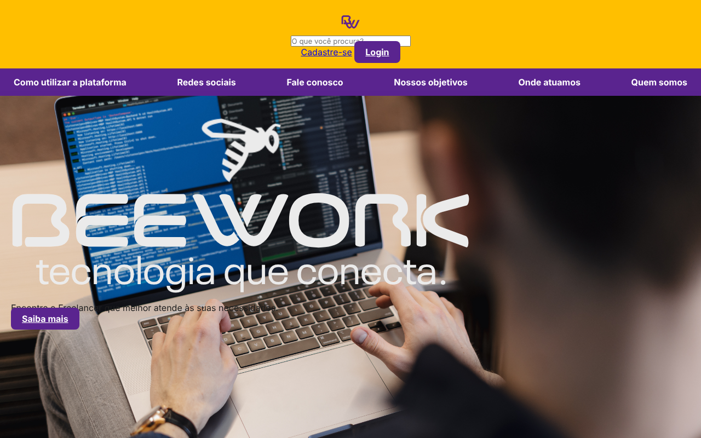
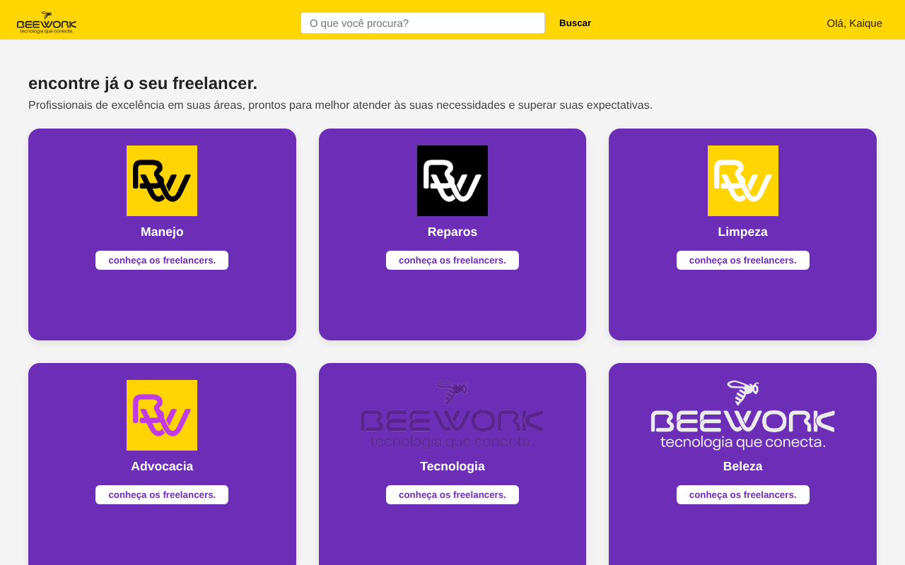
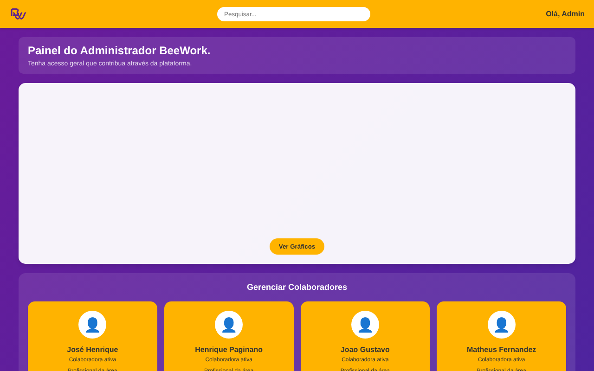

# BeeWork · tecnologia que conecta

Plataforma web para **encontrar e contratar prestadores de serviço autônomos** (freelancers) por categoria: limpeza, reparos, beleza, tecnologia, advocacia e outras. Projeto de TCC desenvolvido em grupo em 2025.



## Telas

| Busca por categoria | Painel do administrador |
|---|---|
|  |  |

## Funcionalidades

- Cadastro e login de usuários (cliente e prestador)
- CRUD completo de **usuários**, **categorias**, **serviços** e **avaliações** (cadastrar, visualizar, atualizar, excluir)
- Pesquisa de usuários
- Avaliação de serviços com estrelas, comentário e opção anônima
- Painel administrativo com gestão de colaboradores e gráficos (Chart.js)

## Tecnologias

- **Back-end:** PHP (mysqli)
- **Banco de dados:** MySQL / MariaDB
- **Front-end:** HTML, CSS, JavaScript, Bootstrap 4, jQuery, Chart.js

## Banco de dados

Quatro tabelas relacionadas por chave estrangeira (`ON DELETE CASCADE`):

- `tbUsuario` · e-mail, CPF, telefone, tipo (cliente/prestador), biografia, CEP
- `tbCategoria` · categorias de serviço
- `tbServico` · serviço oferecido por um usuário em uma categoria, com valor médio e foto
- `tbAvaliacao` · nota em estrelas e comentário de um usuário sobre um serviço

Script em [`banco/bdBeework.sql`](banco/bdBeework.sql).

## Como rodar

Pré-requisito: [XAMPP](https://www.apachefriends.org/) (Apache + PHP + MySQL) ou equivalente.

1. Clone o projeto dentro da pasta `htdocs` do XAMPP:
   ```bash
   cd C:\xampp\htdocs
   git clone https://github.com/zebra22dev/BeeWork.git beework
   ```
2. Inicie **Apache** e **MySQL** no painel do XAMPP.
3. Abra o phpMyAdmin (http://localhost/phpmyadmin), vá em **Importar** e envie `banco/bdBeework.sql`.
4. Se o seu MySQL tiver senha, ajuste `conexao.php` (padrão: usuário `root`, sem senha).
5. Acesse http://localhost/beework/telas/index.html

## Estrutura

```
telas/       páginas HTML (início, login, cadastro, principal, admin)
usuario/     CRUD de usuários (PHP)
categoria/   CRUD de categorias
servico/     CRUD de serviços
avaliacao/   CRUD de avaliações
banco/       script SQL do banco
css/ js/     estilos e scripts do front-end
imagens/     logos e identidade visual
conexao.php  conexão com o MySQL
```

## Equipe

Projeto em grupo. Fork do repositório original [Marsheym/TCC](https://github.com/Marsheym/TCC).

- Henrique Paglione · desenvolvimento do código (PHP, JavaScript e telas)
- Junio Gustavo · modelagem do banco de dados · [@JunioGMoura](https://github.com/JunioGMoura)
- Kaique Reimberg · documentação
